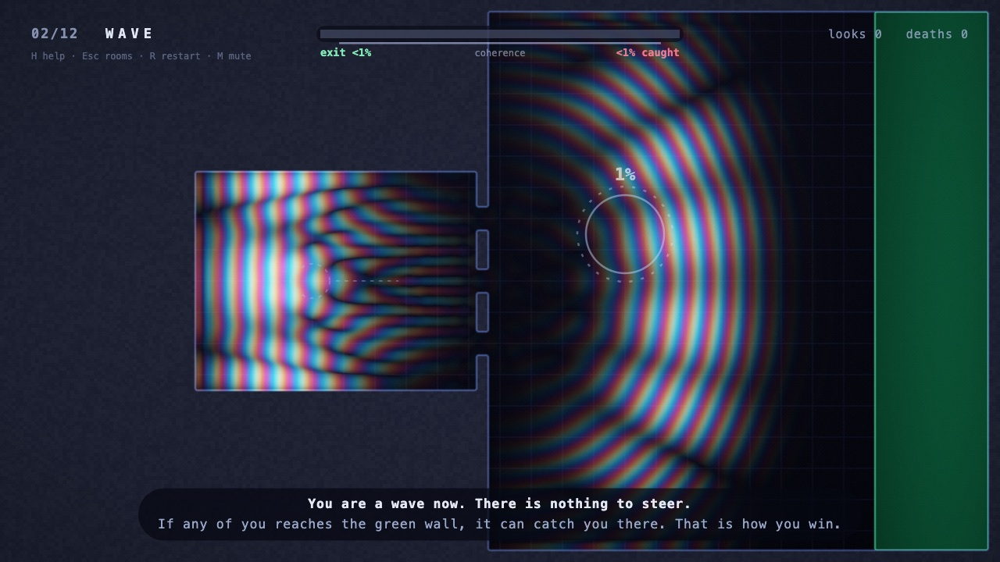
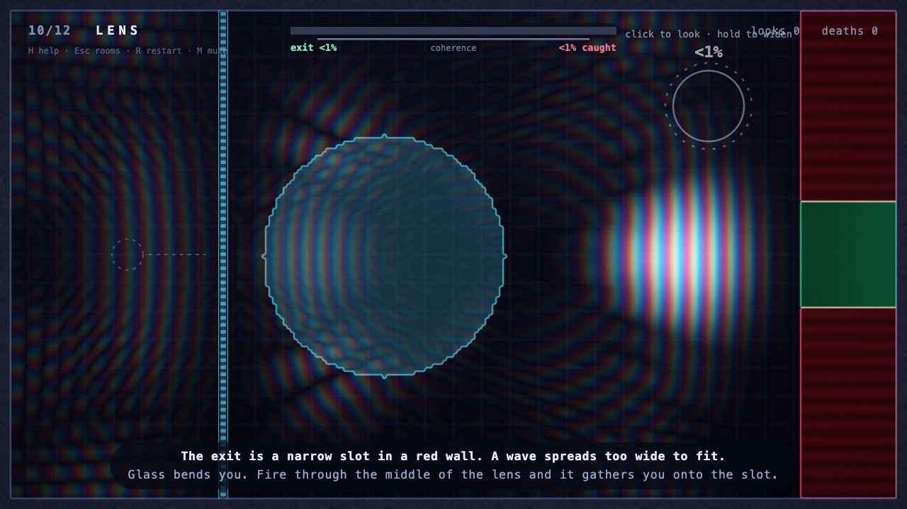
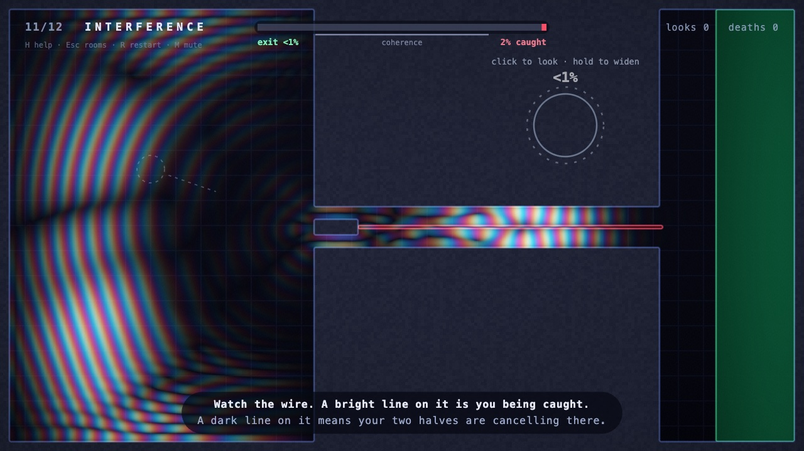

# ψ

**A game about being found.** You are a particle until you choose to be a wave, and the wave is a real 2D Schrödinger equation running in your browser.

**[Play it → psi-omega-seven.vercel.app](https://psi-omega-seven.vercel.app)** (mouse and keyboard)



## How it plays

You walk as a particle, and walls stop you. Hold the mouse button to charge, release, and you become a wave packet that moves by itself: it diffracts through gaps too narrow to walk through, leaks through thin barriers, bounces off walls and interferes with itself.

A wave becomes a particle again in three ways:

1. **Green catches it.** Green detectors are the exit. Any part of the wave they absorb is a chance they catch all of you, and that wins the room.
2. **You look for yourself.** Click on the wave and you are found under the lens with exactly the probability shown. If you are not there, that part of the wave is erased and the rest flies on.
3. **Coherence runs out.** After a few seconds the room measures you, and you appear somewhere the wave was.

Red detectors catch waves too, and that kills you. A longer charge makes a faster wave with a shorter wavelength.

| Control | Action |
| --- | --- |
| `W` `A` `S` `D` or arrows | Walk |
| Mouse | Aim |
| Hold and release (or `Space`) | Charge and become a wave |
| Click while a wave | Look for yourself; hold to widen the lens |
| `H` | How it works |
| `Esc` | Room select |
| `R` `M` `F` `]` | Restart room, mute, fullscreen, skip room |

## The rooms

| # | Room | What it teaches |
| --- | --- | --- |
| 1 | Particle | Walking |
| 2 | Wave | Diffraction through gaps; green catches you |
| 3 | Observer | Looking for yourself, and keys |
| 4 | Tunnel | Fast waves leak through a barrier |
| 5 | Gently | Slow waves glance off a slanted barrier |
| 6 | Mirror | Walls reflect: a bank shot around a detector |
| 7 | Return | Tunnel out, look before the red wall, tunnel back |
| 8 | Scanner | A sweeping detector, and timing |
| 9 | Ricochet | A bounce under one detector and over another |
| 10 | Lens | Glass focuses a wave onto a narrow exit |
| 11 | Interference | Two paths that cancel on a tripwire |
| 12 | Superposition | Everything at once |




## How it works

- **The wave** is a complex field on a 256 × 144 grid, stepped 400 times a second with the Visscher leapfrog scheme (`src/physics.js`). Walls set ψ to zero, barriers and glass are potentials, and the colours you see are the phase of ψ.
- **Detectors** absorb amplitude. Each tick, the norm a colour absorbed divided by the norm that was there is the chance it caught you, and the game rolls exactly that.
- **Looking** is a measurement with a feathered lens. The odds shown are the odds rolled, and a miss applies the matching projection to the wave.
- **The interference room** is mirror-symmetric with a tripwire on its axis. The part of your wave that is odd about that axis is exactly zero on the wire, so approaching the two channels at the right angle makes you invisible to it.
- **Timing** is in fixed 1/120 s ticks, so the game plays the same at 30, 60 or 144 Hz.
- **Rendering** is one WebGL shader that rebuilds a smooth field from the grid; a plain 2D renderer takes over where WebGL is missing. **Sound** is synthesised, and a six-voice choir follows where the wave is.

There is no build step and there are no dependencies: the browser loads the ES modules in `src/` directly.

## Run it locally

```sh
npm start        # serves the game on a local port (ES modules do not load from file://)
```

## Tests

```sh
npm run check     # every room against the physics, in a few seconds, no browser
npm run playtest  # plays all twelve rooms and the menus in headless Chrome with real input
```

`check` proves each room's intended shot wins, its careless shot is clearly worse, and nothing that needs a wave can be walked. `playtest` needs Chrome or Chromium (set `CHROME_PATH` if it is not found) and can target a deployed copy with `--url`. The playtest bot knows each room's solution, so it shows the rooms are winnable through the real input path, not how hard they are to discover.

`node tools/screenshots.mjs` re-renders the images in `docs/`.

## Layout

```
index.html, style.css   the page
src/physics.js          the Schrödinger solver and measurement
src/levels.js           the twelve rooms
src/game.js             the rules
src/renderer.js         WebGL and 2D drawing of the field
src/hud.js              everything drawn on top
src/audio.js            synthesised sound
src/main.js             boot, fixed-tick loop, test hooks
tools/                  level lab, room checks, playtest bot, screenshots
```
